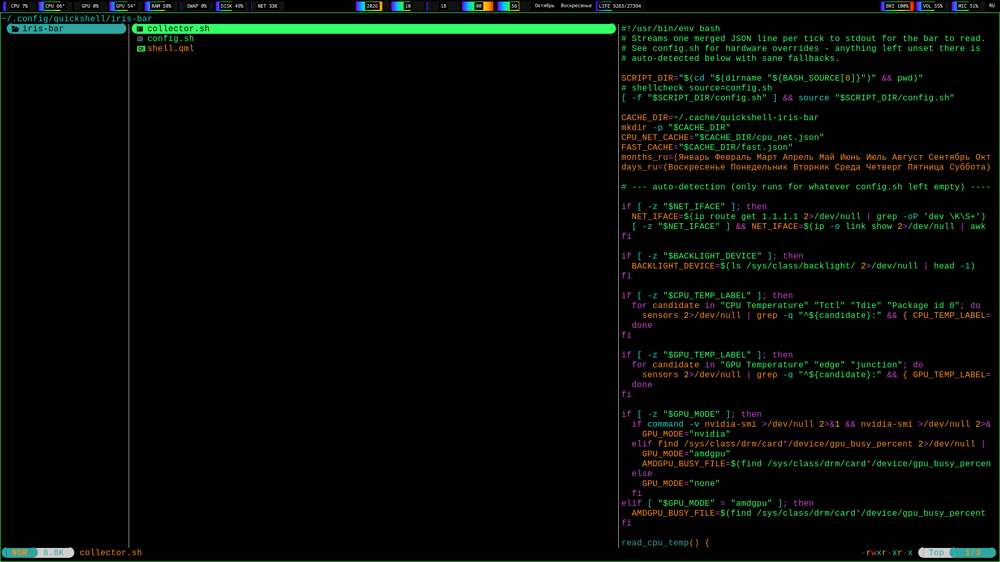

# iris-bar

A minimal, toggleable status bar for [niri](https://github.com/YaLTeR/niri), built on [Quickshell](https://quickshell.outfoxxed.me/). Named after Iris, the Greek goddess of the rainbow.



## Design

Every stat — CPU, GPU, RAM, swap, disk, network, screen brightness, volume, mic, and even the date/time (year/month/day/hour/minute, each as % elapsed through that unit) — is rendered as a horizontal bar on a black background. The fill is a rainbow gradient fixed to position across the full bar width, so the progress reveals more of the same gradient rather than stretching it. The value is overlaid as white text on a small black backdrop.

There's also an optional memento mori bar — days lived / expected total days, based on a birth date and an expectancy-in-years you set yourself. Off by default; set `BIRTH_DATE` in `config.sh` to enable it.

- Toggles on/off with a keybind (no permanent screen real estate unless you want it)
- Reserves screen space when shown (`exclusiveZone`), doesn't just overlay on top of windows
- Fast-reacting: volume/brightness/keyboard-layout changes show up in ~0.3s, not seconds later
- Hardware specifics (network interface, backlight device, sensor labels, GPU vendor) are auto-detected with manual overrides available in `config.sh`

## Requirements

- [Quickshell](https://quickshell.outfoxxed.me/)
- `niri` (for the keyboard-layout indicator specifically; the rest of the bar is compositor-agnostic)
- `lm_sensors` (temperatures)
- `brightnessctl` (screen brightness)
- `wireplumber` / `wpctl` (volume)
- `nvidia-smi` (optional, for Nvidia GPU usage) or an `amdgpu` kernel driver (for AMD GPU usage via sysfs)

## Install

```sh
git clone https://github.com/eqeka/iris-bar.git ~/.config/quickshell/iris-bar
```

Run it:

```sh
qs -c iris-bar
```

Toggle visibility (bind this to a key in your compositor):

```sh
qs -c iris-bar ipc call bar toggle
```

Example niri keybind (`config.kdl`):

```kdl
spawn-at-startup "qs" "-c" "iris-bar"

binds {
    Mod+B repeat=false { spawn "qs" "-c" "iris-bar" "ipc" "call" "bar" "toggle"; }
}
```

## Configuration

Hardware-specific values are auto-detected on first run. If auto-detection
picks the wrong thing (e.g. a hybrid-GPU laptop with a decorative backlight
device), override it explicitly in `config.sh` — see the comments in that
file for each option.

## How it works

`shell.qml` is the Quickshell UI. `collector.sh` is a background script that
streams one JSON line per tick to stdout, read via `Process` + `SplitParser`.
Internally it runs three independent loops so nothing blocks anything else:

- date fields (cheap, computed inline every print)
- CPU/network (needs a genuine 1s delta sample, its own background loop)
- everything else — GPU, RAM, swap, disk, temps, brightness, volume, mic,
  keyboard layout (all instant single-shot reads, own loop at ~0.3s so they
  never inherit the CPU/network loop's unavoidable 1s cadence)

## License

MIT
